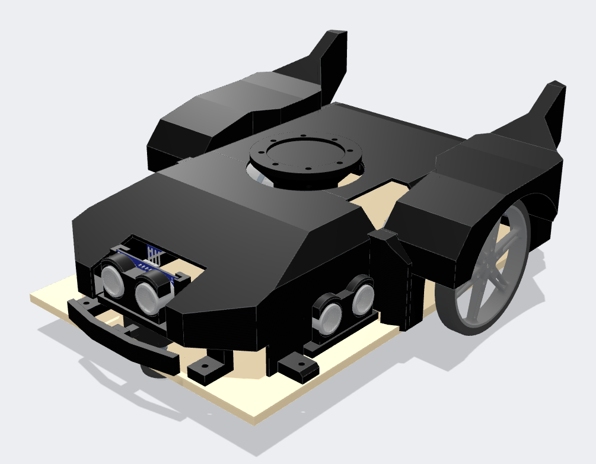
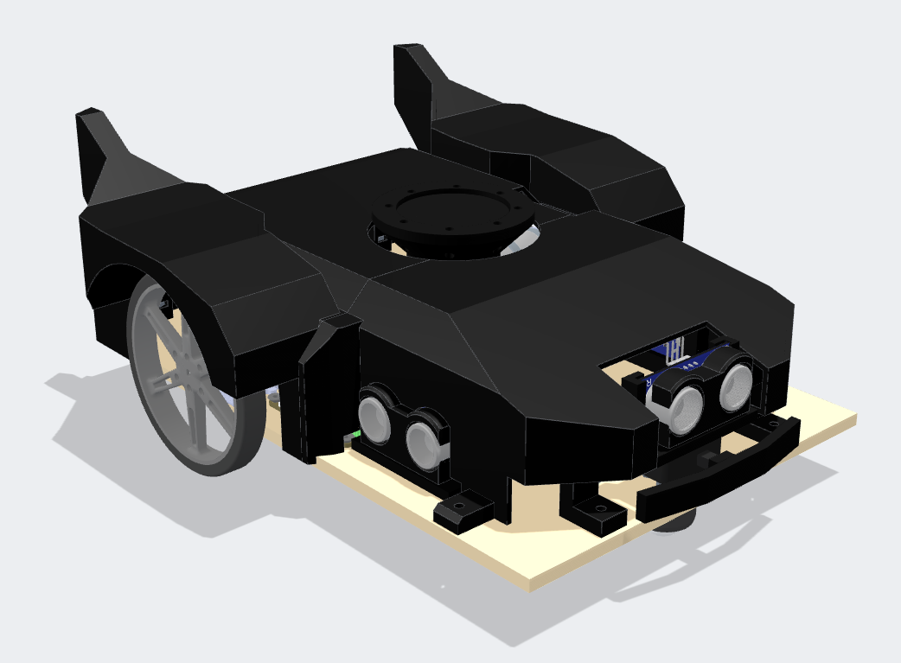
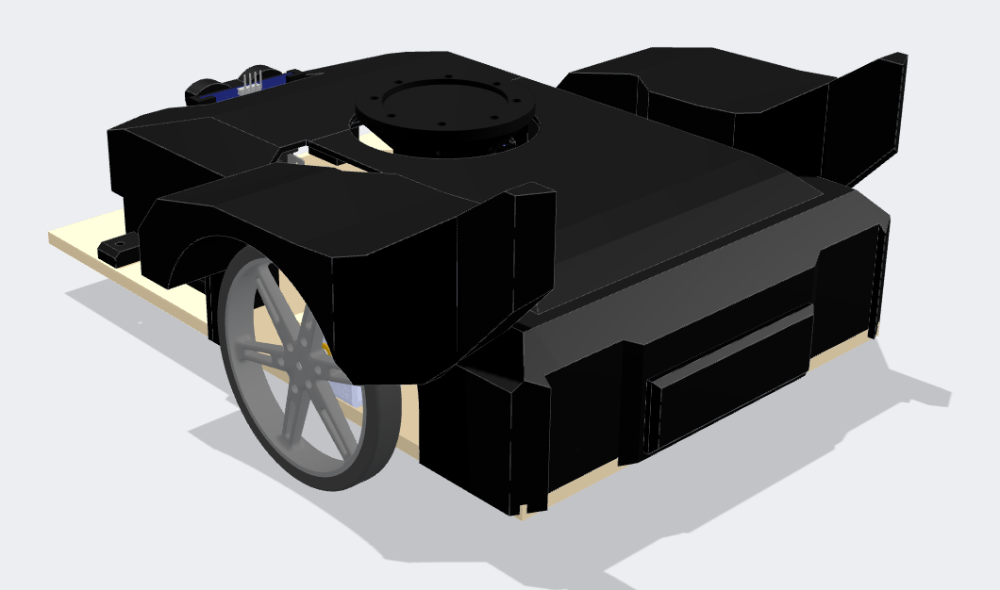
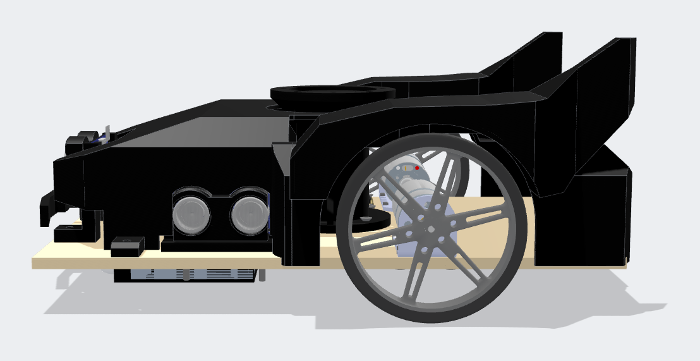
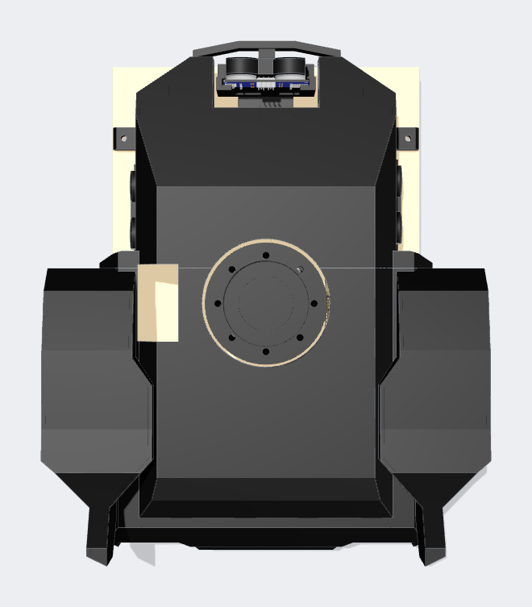
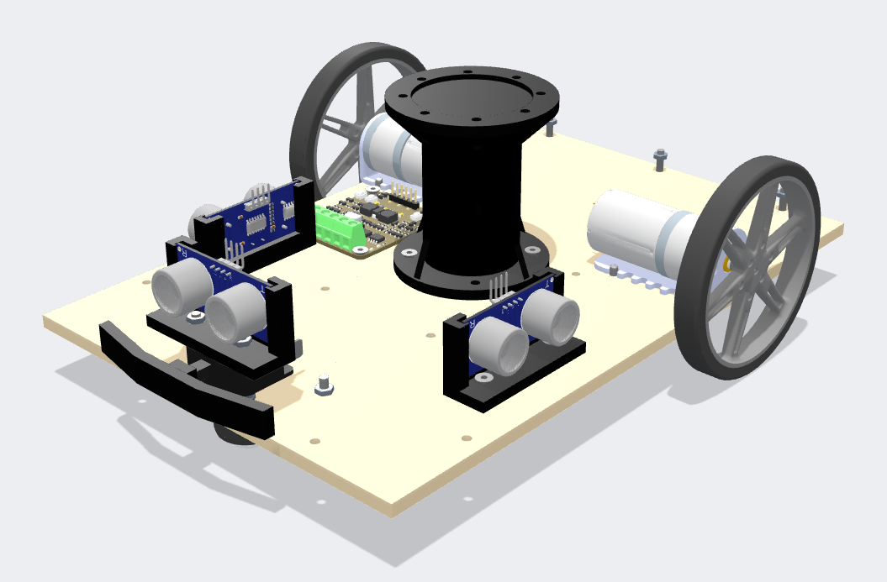

# ECHO als 3D-Modell (Stand 24.11.2026)

Der ganze Roboter in einem Modell. Grundlage ist unsere Creo-Baugruppe `batmobile-v2` (STEP-Export vom 23.11.). Gegenüber dem Export ist zweierlei geändert:

- Die Haube hat die Front vom 23.11. (Nase unten hinten offen, Fußschlitz bis z 6,5). In der Creo-Baugruppe steckt noch die Front vom 20.11.
- Die Räder sitzen wie am 20.11. gemessen, Reifen bei y ±89,7 bis ±99,0. In der Creo-Baugruppe sitzen sie 8 mm weiter außen. Reifen zum Radlauf der Haube jetzt 5,3 bis 5,8 mm.

| Datei | Wofür |
| --- | --- |
| `ECHO_Roboter.stl` | Auf GitHub anklicken, dann lässt sich der Roboter im Browser drehen und zoomen. Ein Netz ohne Farben, in mm |
| `ECHO_Roboter.glb` | 3D-Modell mit Farben. Lässt sich in PowerPoint über Einfügen > 3D-Modelle in eine Folie setzen und dort drehen (z. B. für die Abschlusspräsentation). Öffnet auch in Blender oder im Browser unter https://gltf-viewer.donmccurdy.com (Datei reinziehen, sie bleibt auf dem eigenen Rechner) |
| `ECHO_Roboter_STEP.zip` | CAD-Modell mit echten Volumenkörpern, STEP AP214 in mm. Öffnet in Creo, FreeCAD, Fusion usw. |
| `ECHO_*.png` | Ansichten, siehe unten |

STL und GLB sind Netze. Die Modelle aus dem Internet (HC-SR04, MDD3A, Räder, Motoren, Schrauben) sind darin vereinfacht, weil allein ein HC-SR04 über 180 000 Dreiecke hatte. Haube, Grundplatte und Druckteile sind genau. Für Maße die STEP-Datei nehmen.

## Koordinaten

- STL: Ursprung in der Achsmitte auf der Plattenoberseite, x nach vorne, y nach links, z nach oben, mm
- GLB: Meter, y nach oben, der Roboter schaut nach +z (so erwarten es die meisten Programme)
- STEP: wie die Creo-Baugruppe, Creo X = x, Creo Y = z + 5, Creo Z = −y. Die Haube liegt in der Unterbaugruppe `HAUBE_V7`

## Was im Modell fehlt

Diese Teile sind im STEP-Export vom 23.11. nicht drin, deshalb fehlen sie auch hier:

- Schale mit Ball auf dem Podest
- Steckbrett mit ESP32 (vielleicht eine der zwei unterdrückten Komponenten in Creo)
- Bedienpult mit Wippschalter, durch den Schalterschacht sieht man deshalb auf die Platte
- Kabel

Außerdem stecken in der Creo-Baugruppe zwei Motormodelle an derselben Stelle, `JGA25-370` und `POLOLU-25D-MM-METAL-GEARMOTOR-B`. Eins davon sollte raus, auch wegen der Masse der Baugruppe.

## Ansichten

| | |
| --- | --- |
|  |  |
|  |  |
|  |  |

Ändert sich die Creo-Baugruppe, müssen die Dateien hier neu erzeugt werden.
