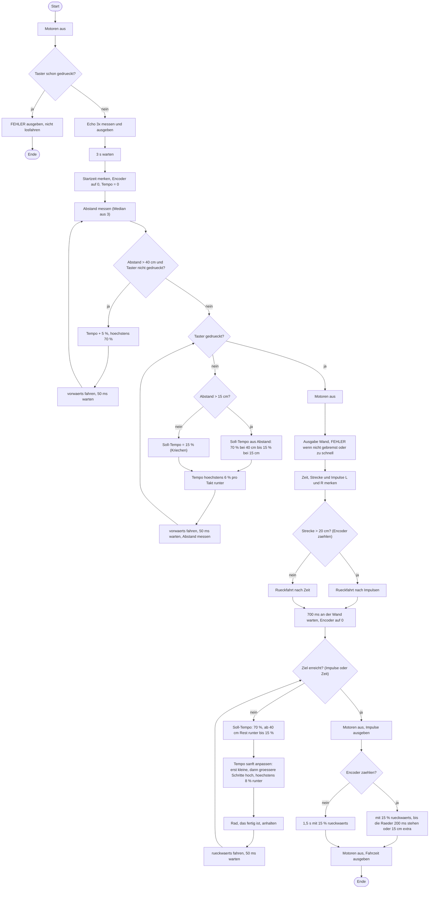

# Flussdiagramm `code/wallsprint.py`

Werte wie im Code: VMAX 70 %, Kriechen 15 %, Bremsen ab 40 cm (Echo), Kriechen ab 15 cm, Rueckfahrt bremst ab 40 cm Rest, Takt 50 ms.
In jeder Schleife gilt: nach 60 s Motoren aus und Abbruch.

`code/wallsprint_drehung.py` hat zusaetzlich in der Hinfahrt: nach 100 cm bis 0 % abbremsen, 0,3 s warten, einmal 360 Grad auf der Stelle drehen (Impulse werden nicht zur Strecke gezaehlt), 0,3 s warten, weiter wie oben.
